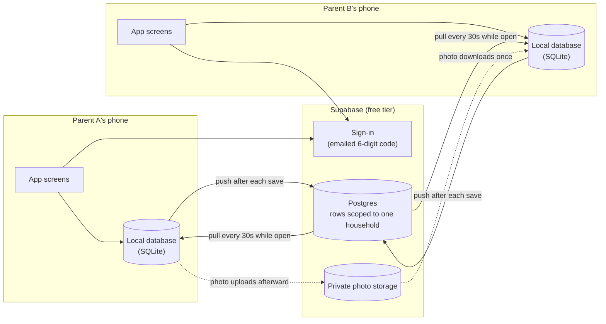

# Architecture overview

Two phones, one household. Each phone keeps its own copy of the data so logging works without a connection, and a small sync layer keeps the copies in sync.

## How it behaves

- **Saving never waits on the network.** Every meal is written to the phone first. A push to the server follows if there's a connection; if it fails, the next refresh retries it.
- **Photos travel separately.** The meal's details sync right away. The photo uploads afterward, so a slow upload never holds up anything else.
- **Conflicts are resolved by "last write wins."** If both parents edit the same meal, the later edit stands. For two people logging a few meals a day, we don't need more complicated logic.
- **Each household sees only its own data.** The database enforces this itself with row-level security, not just the app, so a bug in the app can't expose another family's meals.
- **Joining uses an invite code.** One parent creates the household and shares the code. Households can't be browsed or searched, so codes can't be guessed from the outside.

## Key decisions

| Choice | Alternative considered | Rationale |
|---|---|---|
| Photos in private storage | Public image links | These are photos of a toddler. Nothing is reachable by a public URL. |
| Free tiers only | Any paid service | Zero ongoing cost is a project rule. |
| Local-first with sync | Online-only app | Network connectivity can be unreliable and logging must never block. |
| Refresh every 30 seconds | Instant live updates | The requirement is "within 60 seconds." Live updates would add a second code path for no visible benefit. |
| Emailed 6-digit code | Passwords, or a tappable email link | No password to remember, and no link-handling infrastructure to build. |
| Last write wins | Merging edits field by field | Disproportionate complexity for two users. |
